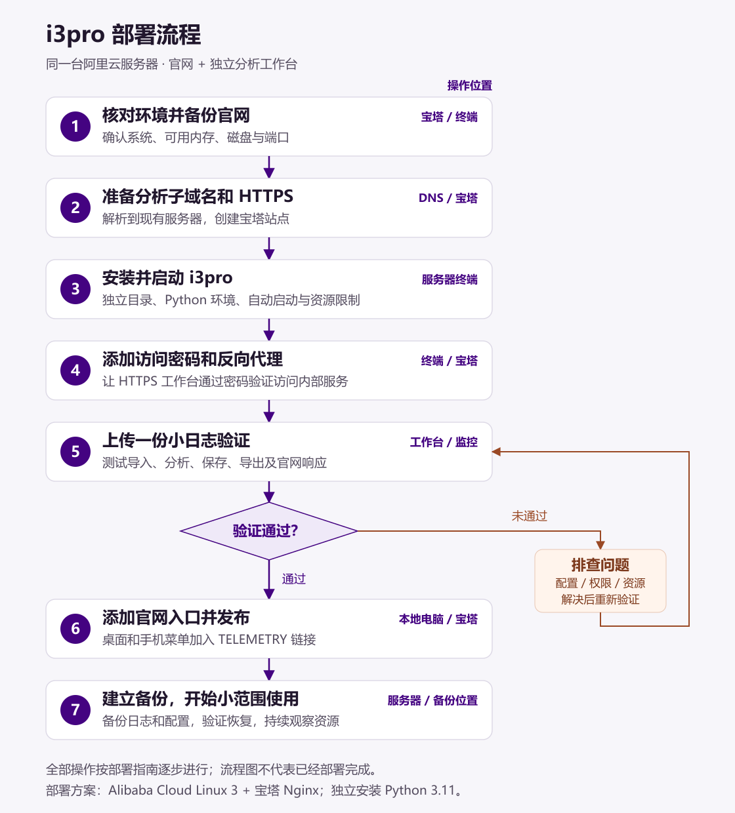

# i3pro 与 Aurora Racing 官网同机部署指南

编写日期：2026-10-12（Asia/Shanghai）。
更新日期：2026-10-13（Asia/Shanghai）。

本文记录部署方案与操作流程。文档中的命令尚未在生产服务器执行，资源预算和日志兼容性需要实际验证。

## 先看这张流程图

整个部署分成七步。第 1～5 步先让分析工作台独立运行并验证，再进行第 6 步的官网入口接入。



[打开清晰版流程图（SVG）](images/i3pro-deployment-flow.svg)。

| 步骤 | 用简单的话说 | 在哪里操作 | 完成标志 | 详细步骤 |
| --- | --- | --- | --- | --- |
| 1. 检查与备份 | 看服务器是否具备运行条件，保存现有官网副本 | 宝塔、服务器终端 | 确认系统、可用内存、磁盘和端口；官网备份已保存 | [第 2 节](#2-部署前检查与备份) |
| 2. 准备访问地址 | 给工作台准备一个新地址，并启用 HTTPS | DNS 控制台、宝塔 | telemetry.aurora-racing.com 解析到服务器，证书正常 | [第 3 节](#3-dns-与宝塔站点) |
| 3. 安装并启动 | 下载 i3pro，安装 Python 依赖，让它自动运行 | 服务器终端、宝塔文件管理 | 服务 active，本机页面和 API 正常返回 | [第 4～6 节](#4-安装程序和依赖) |
| 4. 设置访问入口 | 加上登录密码，让新域名转发到 Python 服务 | 服务器终端、宝塔 Nginx 配置 | 未登录页面和 API 返回 401，登录后工作台可用 | [第 7～8 节](#7-设置工作台访问密码) |
| 5. 验证分析功能 | 用一份小日志走完上传、分析、保存和导出 | 工作台、宝塔监控 | 功能正常，官网仍可访问，服务不反复重启 | [第 10 节](#10-导入数据与上线验收) |
| 6. 接入官网 | 在官网导航放一个打开工作台的链接 | 本地 IDE、宝塔文件管理 | 桌面和手机都能打开工作台，原有导航正常 | [第 9 节](#9-在官网加入工作台入口) |
| 7. 备份与使用 | 备份日志和配置，逐步扩大使用范围 | 服务器、受保护的备份位置 | 备份可读取，恢复验证通过，使用时资源稳定 | [第 11～12 节](#11-备份与恢复) |

三个容易混淆的概念：

- **子域名**是工作台的访问地址，仍指向现有阿里云服务器，无需另买一台服务器。
- **Python 服务**负责读日志、计算和保存分析配置；它在服务器本机运行。
- **反向代理**负责把登录后的浏览器请求交给 Python 服务。用户访问 HTTPS 子域名，内部服务地址由 Nginx 使用。

日常使用时，只需打开官网 → 点击 TELEMETRY → 输入工作台账号密码 → 上传日志并分析。安装和配置属于首次部署流程；账号当前共享数据空间，并非每人独立存储。

操作遇到错误时，先解决当前步骤的问题并重新验证，再继续下一步。第 5 步通过后再发布官网入口；如果服务出现资源问题，可按[回滚说明](#12-日常维护与回滚)停止分析服务。

## 1. 目标与适用环境

在现有阿里云轻量应用服务器上运行官网和 i3pro：

| 服务 | 访问地址 | 运行方式 |
| --- | --- | --- |
| Aurora Racing 官网 | https://aurora-racing.com | 宝塔 Nginx 提供现有 Vite 静态构建产物 |
| i3pro 分析工作台 | https://telemetry.aurora-racing.com | Nginx 密码验证后转发到独立 Python 服务 |
| i3pro 内部服务 | http://127.0.0.1:8731 | 仅服务器本机访问 |

已知服务器配置为 2 核 CPU、1.8GB 内存、39GB 总存储。首版按车队内部共享工作台规划，先安排一人进行上传、修改和导出，再逐步验证并发查看。

服务器系统已由终端输出确认：Alibaba Cloud Linux 3.2104 U12（OpenAnolis Edition），系统 Python 为 3.6.8。本文按 systemd 和宝塔 Nginx 部署；Nginx 类型、资源余量和权限仍按实际环境核对。第 4 节优先使用 Alibaba Cloud Linux 3 安装分支，Ubuntu/Debian 分支仅供其他服务器参考。服务器操作使用 Bash，在宝塔终端或 SSH 中执行；官网源码操作在本地 Windows 项目中执行。

采用子域名是因为上游页面使用 /api、/session 等根路径。直接挂在官网 /telemetry/ 下还需要改造上游路径。第一版通过官网导航打开子域名，无需把工作台重写成 React，也无需引入 MySQL。

## 2. 部署前检查与备份

在宝塔备份现有官网文件和站点 Nginx 配置。将备份保存到网站公开目录之外，并保留一份服务器之外的副本。

以服务器管理员身份逐步执行以下检查：

```bash
cat /etc/os-release
python3 --version
systemctl --version
stat -fc %T /sys/fs/cgroup
free -h
swapon --show
df -h
ss -lntp
```

检查结果：

- 本服务器为 Alibaba Cloud Linux 3，使用 yum 安装分支，不执行 Ubuntu/Debian 的 apt 命令。
- 系统 Python 3.6.8 不满足 i3pro 的要求；单独安装 Python 3.11，不替换系统 Python。
- 内存关注 available，不只看 free。1.8GB 是总内存，不是可供 i3pro 使用的余量。
- /opt 和 /srv 所在文件系统是否有足够剩余空间。
- 8731 端口是否空闲。
- 宝塔是否确实使用 Nginx，而非 Apache。
- cgroup 文件系统是否为 cgroup2fs，以及服务器是否已经配置 swap。

如果系统 Python 过旧，使用独立安装且版本满足要求的 Python 创建虚拟环境，不要替换系统 Python。记录这个解释器的绝对路径，第 4 节使用该路径创建虚拟环境。

如果任一步失败，先解决该步错误，再继续后续配置。

## 3. DNS 与宝塔站点

在域名 DNS 控制台添加记录：

| 字段 | 值 |
| --- | --- |
| 记录类型 | A |
| 主机记录 | telemetry |
| 记录值 | 当前阿里云服务器的公网 IPv4 地址 |

随后在宝塔执行：

1. 网站 → 添加站点，域名填写 telemetry.aurora-racing.com。
2. 选择纯静态站点，不创建数据库。
3. 等待 DNS 生效，为新站点申请 SSL 证书。
4. 开启强制 HTTPS。
5. 保留现有官网站点的域名、根目录和配置。

公网访问沿用 80/443 端口。i3pro 只绑定 127.0.0.1，无需在阿里云或宝塔防火墙中开放 8731。新子域名初始页面暂时不要放入分析数据；完成密码保护后再对外使用。

## 4. 安装程序和依赖

以下是首次部署流程，使用服务器 root 管理员执行。先确认 /opt/i3pro 不存在；如已经存在旧部署，应检查原有内容，不能覆盖或删除后重来。

目录规划：

```text
/opt/i3pro/                    上游程序源码
/opt/i3pro/.venv/              独立 Python 虚拟环境
/srv/i3pro/data/               原始日志和场次配置 JSON
/srv/i3pro/data/dbc/           CAN 解码所需 DBC
/srv/i3pro/worksheets/         可编辑工作表
/srv/i3pro/maths/              全局数学通道配置
/etc/i3pro-auth/htpasswd       Nginx 登录密码哈希文件
/etc/systemd/system/i3pro.service
```

原始日志不能放在官网 public/、dist/ 或公开的网站根目录：public/ 会被现有脚本同步到 CDN，dist/ 会在构建时清理。

### 4.1 本服务器：Alibaba Cloud Linux 3

官方仓库支持并行安装 Python 3.11。系统 Python 3.6 被系统工具使用，应保留 /usr/bin/python3 的原有指向，不通过软链接或 alternatives 将其改成 3.11。[阿里云官方安装说明](https://help.aliyun.com/zh/alinux/support/install-a-newer-python-3-on-alibaba-cloud-linux-3)

使用服务器 root 管理员逐行执行，当前命令成功后再继续下一条：

```bash
yum install -y python3.11
python3.11 --version
command -v python3.11
yum install -y git httpd-tools
```

期望新解释器显示 Python 3.11.x。httpd-tools 提供后文使用的 htpasswd 命令，无需安装 Apache 服务。默认 python3 --version 仍显示 3.6.8 是预期情况，i3pro 后续使用自己的虚拟环境。

安装失败、软件源找不到包或版本不正确时先记录报错并解决，不直接转为源码编译。下面使用 /usr/bin/python3.11；如果 command -v 返回不同绝对路径，需要同步替换变量值。

```bash
I3PRO_PYTHON=/usr/bin/python3.11
"$I3PRO_PYTHON" -c 'import sys; assert sys.version_info >= (3, 10), "需要 Python 3.10 或更新版本"; print(sys.executable, sys.version)'
```

该分支验证通过后，直接进入第 4.3 节；不执行第 4.2 节。

### 4.2 其他服务器参考：Ubuntu/Debian

只有服务器系统确实为 Ubuntu/Debian 时，才执行此分支：

```bash
apt update
apt install -y git python3 python3-venv python3-pip apache2-utils
python3 --version
```

选择实际可用的 Python 解释器。以下路径是 Ubuntu/Debian 分支示例：系统 Python 已满足要求时可以使用 /usr/bin/python3；否则把变量值改为已安装且满足要求的解释器绝对路径，例如 /usr/bin/python3.11，并确认该版本的 venv 模块可用。本台 Alibaba Cloud Linux 服务器使用第 4.1 节中的变量设置。

```bash
I3PRO_PYTHON=/usr/bin/python3
"$I3PRO_PYTHON" -c 'import sys; assert sys.version_info >= (3, 10), "需要 Python 3.10 或更新版本"; print(sys.executable, sys.version)'
```

### 4.3 下载程序并创建虚拟环境

完成对应系统分支并通过版本检查后，在同一个终端继续下载程序并创建虚拟环境。换了终端时，需要重新设置并检查 I3PRO_PYTHON；本服务器的预期值为 /usr/bin/python3.11。

```bash
git clone https://github.com/fyl66/i3pro.git /opt/i3pro
cd /opt/i3pro
git checkout 9c333382e720c65a644c8652885bc822fcecbedc
"$I3PRO_PYTHON" -m venv /opt/i3pro/.venv
.venv/bin/python --version
.venv/bin/python -m pip install --upgrade pip
.venv/bin/python -m pip install --only-binary=:all: -r requirements.txt
.venv/bin/python -m pip install --no-deps -e .
.venv/bin/python -m i3pro --help
```

虚拟环境内的 Python 应为 3.11.x。如果创建环境提示 venv、ensurepip 或 pip 组件缺失，先记录完整报错并检查对应 Python 3.11 的仓库组件，不用系统 Python 3.6 的 pip 安装 i3pro 依赖。

固定提交是本次核对的上游版本，便于复现和回滚。该版本依赖 numpy、pandas、pyarrow、openpyxl。依赖版本最终由安装时的 Python 和软件包解析结果确定，因此还需要记录实际版本。

--only-binary=:all: 避免在小内存服务器上编译运行依赖。如果提示没有匹配的发行包，检查 Python、CPU 架构、系统兼容性和软件源，不要直接改成源码编译。网络下载失败时也应先解决网络问题。

记录安装结果：

```bash
/opt/i3pro/.venv/bin/python -m pip freeze > /opt/i3pro/requirements.lock.txt
git -C /opt/i3pro rev-parse HEAD
```

保留上游 LICENSE 和版权声明。项目使用 GPL-3.0；后续复制、修改或分发源码时应核对相应授权要求。

## 5. 创建运行账号与数据目录

运行账号 i3pro 只负责分析服务，程序源码由管理员维护。以下 useradd 命令只用于首次创建；如账号已存在，先核实用途和权限。

复制前，确认固定版本中的配置目录确实存在，并检查 DBC 文件列表：

```bash
ls -ld /opt/i3pro/worksheets /opt/i3pro/maths /opt/i3pro/i2pro_data/dbc
find /opt/i3pro/i2pro_data/dbc -type f -name '*.dbc'
```

目录缺失时先核对克隆与固定提交；使用 CAN 日志时，还需要确认 DBC 与实际车辆报文匹配。

```bash
useradd --system --user-group --home-dir /srv/i3pro --no-create-home --shell /usr/sbin/nologin i3pro
mkdir -p /srv/i3pro/data
cp -r /opt/i3pro/worksheets /srv/i3pro/
cp -r /opt/i3pro/maths /srv/i3pro/
cp -r /opt/i3pro/i2pro_data/dbc /srv/i3pro/data/
chown -R i3pro:i3pro /srv/i3pro
```

后续升级不要重新执行 cp 命令覆盖已编辑的工作表和数学定义。

--maths 和 --worksheets 参数填写的是包含 maths/、worksheets/ 的根目录，因此后文均使用 /srv/i3pro，而不是 /srv/i3pro/maths 或 /srv/i3pro/worksheets。

## 6. 配置 systemd 服务

上游命令行在端口冲突时会尝试后续端口，而 Nginx 固定转发 8731。为让端口冲突明确失败，在服务器创建 /opt/i3pro/run_service.py，调用该固定版本的 Python 服务接口，并将尝试次数设为 1：

```python
from i3pro.server import serve


if __name__ == "__main__":
    serve(
        roots=["/srv/i3pro/data"],
        host="127.0.0.1",
        port=8731,
        cache_size=1,
        port_attempts=1,
        maths_root="/srv/i3pro",
        worksheets_root="/srv/i3pro",
    )
```

该文件由管理员维护，i3pro 运行账号只需读取权限。这是本部署的启动入口，不修改上游源码；程序升级时需重新核对 serve() 的参数兼容性。

通过宝塔文件管理器创建 /etc/systemd/system/i3pro.service，内容如下：

```ini
[Unit]
Description=Aurora Racing i3pro
After=network.target
StartLimitIntervalSec=300
StartLimitBurst=5

[Service]
Type=simple
User=i3pro
Group=i3pro
WorkingDirectory=/opt/i3pro

Environment=PYTHONUNBUFFERED=1
Environment=OPENBLAS_NUM_THREADS=1
Environment=OMP_NUM_THREADS=1
Environment=MKL_NUM_THREADS=1

ExecStart=/opt/i3pro/.venv/bin/python /opt/i3pro/run_service.py

Restart=on-failure
RestartSec=10
MemoryAccounting=true
MemoryMax=900M
CPUQuota=100%
PrivateTmp=true
NoNewPrivileges=true

[Install]
WantedBy=multi-user.target
```

初始资源设置说明：

| 参数 | 用途 | 注意事项 |
| --- | --- | --- |
| cache_size=1 | 与命令行 --cache 1 等价，降低缓存场次数量 | 不等于只允许一个用户，也不是内存上限 |
| port_attempts=1 | 只尝试绑定 8731 | 端口被占用时明确失败，避免漂移 |
| StartLimitIntervalSec / StartLimitBurst | 限制反复启动 | 300 秒窗口内最多允许 5 次启动尝试 |
| MemoryMax=900M | 设置服务内存保护上限 | 这是试用预算，不是已验证的需求；超限可能终止进程 |
| CPUQuota=100% | 约限制为一个核心的 CPU 时间 | 为 2 核服务器上的其他服务保留计算余量 |
| 数值库线程数设置 | 限制相关计算库的线程数 | 不等于将整个 HTTP 服务改成单线程 |
| PrivateTmp=true | 为服务提供独立临时目录 | 原始日志和持久化配置仍位于 /srv/i3pro |

先根据部署前 available 内存和已有服务负载评估 900M 是否合适。内存限制依赖系统 cgroup 支持，应检查 systemd 日志是否存在不支持或未生效的提示。即使设置限制，也不能据此保证所有日志都能处理。

如果已确认使用 cgroup v2，并根据实测确定软限制预算，可在 [Service] 中增加低于 MemoryMax 的 MemoryHigh，例如 MemoryHigh=700M。软限制用于主动回收和压制，不保证避免 OOM；示例值同样需要实测，暂不提高现有 900M 硬上限。

swap 是否增加以及容量多少需要检查已有配置、磁盘余量和负载后决定。不要直接覆盖已有 /swapfile 或重复写入 /etc/fstab；swap 也不能替代实际内存。MemorySwapMax 等设置需要确认系统支持及实际效果后再引入。

验证服务文件，然后启动：

```bash
/opt/i3pro/.venv/bin/python -m py_compile /opt/i3pro/run_service.py
systemd-analyze verify /etc/systemd/system/i3pro.service
systemctl daemon-reload
systemctl enable --now i3pro
systemctl status i3pro --no-pager
systemctl show i3pro -p MainPID
ss -lntp
curl -I http://127.0.0.1:8731/
curl http://127.0.0.1:8731/api/sessions
```

期望服务处于 active 状态，监听地址为 127.0.0.1:8731，接口返回正常 JSON。未上传日志时，列表为空是正常情况。

必须核对实际监听端口、监听进程 PID 和 systemd 的 MainPID；它们应对应本服务，不能只确认“8731 有程序监听”。当前启动入口已关闭端口漂移，端口占用会触发启动失败。

如果触发启动次数限制，先修复端口、依赖或资源问题，再恢复服务：

```bash
systemctl reset-failed i3pro
systemctl start i3pro
```

查看启动错误：

```bash
journalctl -u i3pro -n 100 --no-pager
```

## 7. 设置工作台访问密码

第一版使用 Nginx HTTP Basic Authentication，保护工作台页面、上传和分析 API。

首次创建密码文件：

```bash
mkdir -p /etc/i3pro-auth
htpasswd -cB /etc/i3pro-auth/htpasswd aurora
```

按提示交互输入密码，不把明文密码写进命令、文档、环境变量或 React 源码。

在宝塔 Nginx 主配置中确认 user 设置。若实际运行组为 www，执行：

```bash
chown root:www /etc/i3pro-auth/htpasswd
chmod 640 /etc/i3pro-auth/htpasswd
```

如果组名不同，将 www 替换成实际组名；确保 Nginx worker 能读取文件。

增加账号或修改密码时不使用 -c：

```bash
htpasswd -B /etc/i3pro-auth/htpasswd member1
```

第一版所有登录账号访问同一个数据空间。密码验证不提供场次归属、个人私有数据或只读/编辑角色；同一场次先约定由一人编辑，避免互相覆盖。

## 8. 配置宝塔 Nginx 反向代理

只编辑 telemetry.aurora-racing.com 站点。先备份该站点配置，再保留宝塔生成的 SSL、证书验证路径和 HTTPS 跳转配置。

检查该站点是否已有 location /、反向代理 include、PHP 或其他业务 location。合并或移除重复的根路径处理，避免同一站点存在两套冲突配置；不要改动现有官网站点。

先核对宝塔实际用于 HTTP-01 证书校验的磁盘目录和现有 location。以下 root 只是常见路径示例，必须与宝塔实际写入校验文件的位置一致；已有等价的更长前缀 location 时合并配置，不重复添加。下述示例应覆盖证书验证实际经过的 HTTP/HTTPS 站点配置。

```nginx
location ^~ /.well-known/acme-challenge/ {
    root /www/wwwroot/telemetry.aurora-racing.com;
    default_type text/plain;
    auth_basic off;
    allow all;
    try_files $uri =404;
}
```

更长的前缀 location 会优先匹配，因此证书校验请求可以从磁盘读取，其他请求再进入分析服务。检查宝塔生成的 include 和重定向规则：如果 HTTP 站点跳转到 HTTPS，最终校验路径仍应正常返回文件。使用 DNS-01 签发时，这条 HTTP 路径不是签发的必要条件，应按实际验证方式配置。

在提供 HTTPS 服务的 server 块中，使用以下根路径处理：

```nginx
location ^~ / {
    auth_basic "Aurora Telemetry";
    auth_basic_user_file /etc/i3pro-auth/htpasswd;

    client_max_body_size 50m;
    client_body_timeout 300s;

    proxy_pass http://127.0.0.1:8731;
    proxy_http_version 1.1;

    proxy_set_header Host $host;
    proxy_set_header X-Real-IP $remote_addr;
    proxy_set_header X-Forwarded-For $proxy_add_x_forwarded_for;
    proxy_set_header X-Forwarded-Proto $scheme;
    proxy_set_header Connection "";

    proxy_connect_timeout 10s;
    proxy_read_timeout 300s;
    proxy_send_timeout 300s;
    proxy_request_buffering on;
    proxy_buffering off;
    proxy_cache off;
}
```

说明：

- 50m 是初始请求体大小限制，不是文件内存占用估算，也不能保证该大小的文件均可分析。
- 固定版本的上传接口按块读取并写盘；文件解析和分析仍可能产生较高内存峰值，上传限制需要结合真实日志测量。
- proxy_pass 使用根路径转发，适配上游 /api 和 /session。
- proxy_request_buffering on 缓冲上传请求，保持当前兼容配置。后端依赖 Content-Length，不应未经验证改成 chunked 上传。
- proxy_buffering off 关闭响应缓冲，以减少低并发导出时 Nginx 的临时文件写入；慢客户端下载期间会更久地占用 Python 线程。响应缓冲开启并不意味着必须收完整个文件后才向用户发送。
- proxy_cache off 明确关闭响应缓存，包括从上层继承的缓存设置；它与上述请求/响应缓冲是三个不同概念。
- proxy_read_timeout 是等待上游数据的间隔上限，proxy_send_timeout 是向上游写入数据的间隔上限，并非整个任务或下载的总时长；超时也不会强制停止后端计算任务。
- CPUQuota 可能影响计算耗时，但不保证耗时翻倍。要同时测量分析时间与超时表现，尤其是生成导出文件前长时间没有响应数据的情况。
- 新子域名直接解析到服务器，认证页面、分析 API 和内部数据不接入现有公开 CDN。
- 保留宝塔用于证书验证的专用路径；如果站点其他更具体的 location 处理业务或数据请求，需要一并确认访问控制。

使用宝塔检查 Nginx 配置并重载。浏览器访问 https://telemetry.aurora-racing.com，应先出现密码提示，登录后进入工作台。

验证 API 也受到密码保护：

```bash
curl -I https://telemetry.aurora-racing.com/api/sessions
curl -u aurora https://telemetry.aurora-racing.com/api/sessions
```

第一条应返回 401；第二条交互输入密码后应返回正常 JSON。不要在 curl 参数中写入明文密码。

确认未登录用户无法上传或修改分析配置。

通过宝塔在实际校验目录创建一个内容已知、名称未被占用的测试文件，例如 .well-known/acme-challenge/aurora-i3pro-check-20261013.txt，内容为 aurora-i3pro-acme-check。用未登录请求测试：

```bash
curl -iL --max-redirs 5 http://telemetry.aurora-racing.com/.well-known/acme-challenge/aurora-i3pro-check-20261013.txt
curl -i https://telemetry.aurora-racing.com/.well-known/acme-challenge/aurora-i3pro-check-20261013.txt
```

两条请求最终都应返回 200 和正确正文，不应要求工作台密码。不存在的路径返回 404 不能证明校验通道正常。验证结束后仅删除本次创建的测试文件，不动宝塔生成的实际校验文件。

续期验证使用当前证书管理工具：宝塔管理的证书按宝塔实际续期流程验证；只有确实使用 Certbot 管理该证书时，才执行 certbot renew --dry-run。不要为了测试另装一套证书管理工具。

## 9. 在官网加入工作台入口

**2026-10-13 实现更新：** 本地 `Navbar.tsx` 已加入桌面最右侧和手机菜单最底部的 TELEMETRY 入口，并新增独立品牌登录页。下面保留原先的 Basic Auth 外链示例供理解，不要再次粘贴而产生重复入口。新登录页与现有账号的接入、文件上传及宝塔配置，见 [工作台品牌登录页接入](I3PRO_LOGIN_SETUP.md)。本地代码完成不代表生产服务器已发布。

这一步在本地 Aurora Racing 项目中操作。源文件为 src/components/Navbar.tsx。

当前桌面使用 Hash 路由，手机使用锚点滚动。handleNavClick 会把不认识的目标映射回首页，因此分析入口直接使用外部链接，不调用这个函数。

在桌面导航容器内，NAV_ITEMS.map(...) 结束后加入：

```tsx
<a
  href="https://telemetry.aurora-racing.com"
  target="_blank"
  rel="noopener noreferrer"
  className="text-sm font-medium tracking-widest text-aurora-white/80 hover:text-aurora-purple transition-colors py-4"
>
  TELEMETRY
</a>
```

在手机菜单容器内，NAV_ITEMS.map(...) 结束后加入：

```tsx
<a
  href="https://telemetry.aurora-racing.com"
  target="_blank"
  rel="noopener noreferrer"
  onClick={() => setIsMobileMenuOpen(false)}
  className="py-2.5 text-lg font-medium tracking-widest text-aurora-white/90 hover:text-aurora-purple transition-colors"
>
  TELEMETRY
</a>
```

当前入口已在 Navbar.tsx 中实现；实际样式以源码为准。

本地 PowerShell 执行：

```powershell
npm.cmd run lint
npm.cmd run build
npm.cmd run verify:assets
```

检查桌面、平板宽度下导航是否拥挤，手机菜单是否正常收起，原有赛车和队员下拉菜单是否正常。可以使用 npm.cmd run preview 预览构建产物。

若新增了图片等 public/ 资源，按现有项目流程先同步资源并重新验证 CDN 可达性。只有检查通过后，才将新 dist/ 内容上传到现有官网站点根目录。不要将 Python 程序、数据或密码文件放进官网 dist/。

## 10. 导入数据与上线验收

先通过工作台上传一份较小的真实日志，再逐步测试典型大文件。MoTeC 日志有配套 .ldx 时也应按实际需要导入；CSV、Excel 和 CAN 数据需要核对时间列、采样率、单位和 DBC。

记录每次试验的文件格式、文件大小、通道数量、处理耗时、内存峰值、是否触发重启以及官网访问表现。不要用上游作者机器上的性能数字代替本服务器实测。

验收清单：

- [ ] 未登录访问工作台和 API 均被拦截。
- [ ] 证书校验测试文件在未登录状态下返回 200 和正确正文，HTTP 跳转正常。
- [ ] 当前证书管理工具的签发/续期验证通过。
- [ ] 登录后能上传并看到场次。
- [ ] 通道名称、单位、时间轴与原始数据一致。
- [ ] 图表缩放、切圈、双圈对比符合实际数据。
- [ ] 保存注释、工作表等配置后，刷新页面能恢复。
- [ ] CSV/Excel 导出的范围、采样率和内容正确。
- [ ] 超过初始上传限制时返回明确错误。
- [ ] 接近上传上限的真实日志完成解析和分析，资源峰值在预算内；不会只测上传写盘。
- [ ] 分析期间官网正常响应，桌面和手机导航正常。
- [ ] 服务没有反复重启，磁盘空间没有异常增长。
- [ ] 监听 8731 的进程与本服务 MainPID 一致，启动冲突和失败可从日志明确定位。
- [ ] 重启分析服务后能恢复场次和持久化配置。
- [ ] 在维护窗口验证开机自动启动。

服务器观察命令：

```bash
systemctl show i3pro -p MemoryCurrent -p MemoryMax -p CPUUsageNSec
systemctl status i3pro --no-pager
journalctl -u i3pro -n 100 --no-pager
free -h
df -h
```

MemoryCurrent 是当前值，不等于全过程峰值。用宝塔监控曲线或持续监控记录导入、解析和导出的资源变化；支持 MemoryPeak 属性的 systemd 版本也可查询该属性，旧版本不能假定它存在。确认配置的内存限制和 CPU 配额实际生效，再决定是否放宽文件大小和并发。

先完成一人操作的典型日志验证，再增加同时查看人数。多用户身份隔离、自动任务排队、总存储配额和审计不在本部署示例中，需要后续按需求实现。

## 11. 备份与恢复

备份需要覆盖 /srv/i3pro 中的原始日志、分析配置、DBC、工作表和数学定义，以及程序提交号、依赖清单、run_service.py 启动入口、systemd 文件、新站点 Nginx 配置和密码哈希文件。

在维护窗口停止服务后进行一致性备份。以下备份目录应位于公开网站根目录之外，并确认当前磁盘能容纳备份：

```bash
mkdir -p /var/backups/i3pro
chmod 700 /var/backups/i3pro
systemctl stop i3pro
```

将下面文件名中的日期与序号替换为本次备份标识，使用新的文件名，不覆盖已有备份：

```bash
tar -czf /var/backups/i3pro/data-20261012-01.tar.gz -C /srv i3pro
chmod 600 /var/backups/i3pro/data-20261012-01.tar.gz
tar -tzf /var/backups/i3pro/data-20261012-01.tar.gz
systemctl start i3pro
systemctl status i3pro --no-pager
```

tar 报错时先核查备份状态；无论备份是否成功，维护结束前都应确认服务已恢复。上述压缩包只覆盖持久化数据，其他配置和依赖记录需同时复制到受保护的备份位置。带密码哈希的文件不能放进公开下载目录或 Git 仓库。

39GB 是整台服务器总存储，不能将全部容量留给日志。建立备份保留策略，并保留一份服务器之外的副本；同机备份无法应对整机或磁盘损坏。

恢复前先在单独目录解包检查，保留当前数据副本，再停止服务并按维护计划恢复。恢复后的 /srv/i3pro 应由 i3pro:i3pro 拥有，随后启动服务并完成登录、场次读取和保存验证。不要直接对运行中的数据目录覆盖解压。

## 12. 日常维护与回滚

常用服务命令：

```bash
systemctl status i3pro --no-pager
systemctl restart i3pro
journalctl -u i3pro -n 100 --no-pager
```

检查 journal 和磁盘占用：

```bash
journalctl --disk-usage
df -h
```

Nginx 访问/错误日志另由宝塔或 logrotate 管理，需核对轮转设置。若 journal 占用明显增长，可按服务器现有保留策略设置 journald 的容量预算；SystemMaxUse 影响整台服务器的持久化 journal，RuntimeMaxUse 影响运行时 journal，不能当作只限制 i3pro。先检查现有策略，再在维护窗口调整，不统一强制设成 200M。

修改 systemd 文件后：

```bash
systemd-analyze verify /etc/systemd/system/i3pro.service
systemctl daemon-reload
systemctl restart i3pro
```

程序升级应先备份持久化数据、记录当前提交与依赖，在隔离环境验证新版本，再安排停机更新。不直接在生产环境盲目 git pull；保留可回滚的程序和依赖环境，数据格式改变时同时保留升级前数据。

出现资源异常时先停止分析服务：

```bash
systemctl stop i3pro
```

如需暂停开机启动：

```bash
systemctl disable i3pro
```

分析服务停止后 telemetry 站点可能显示 502；可将该站点调整为维护页，并暂时移除官网入口。官网仍由原站点提供静态文件。恢复官网导航时使用已备份的官网版本，不删除分析数据。

## 13. 常见问题

| 现象 | 优先检查 |
| --- | --- |
| 域名访问不到 | DNS 解析、服务器 80/443、宝塔站点绑定、SSL |
| 502 Bad Gateway | i3pro 服务状态、实际监听端口、127.0.0.1:8731 是否可访问 |
| 上传返回 413 | Nginx 请求体限制；先验证容量再提高限制 |
| 请求返回 504 | 后端耗时和日志；超时不等于计算已取消 |
| 登录失败或认证相关 500 | 账号、密码文件路径、Nginx worker 读取权限、错误日志 |
| 页面正常但 API 无法访问 | location 优先级、认证范围、请求路径和浏览器 Network |
| 证书签发或续期失败 | 当前验证方式、校验目录、ACME location、HTTP/HTTPS 跳转及已知文件测试 |
| 服务触发 start-limit-hit | 先修复日志中的启动失败原因，再 reset-failed 并启动 |
| 保存失败 | /srv/i3pro 权限、磁盘容量、maths/worksheets 根目录参数 |
| 服务反复重启 | journalctl、内存超限、端口占用、依赖或日志解析错误 |
| 大文件导入时官网变慢 | 内存和 CPU 压力、上传/导出带宽、请求并发 |
| 官网 TELEMETRY 点击回首页 | 外部链接被 handleNavClick 拦截；使用独立 a 链接 |

## 14. 参考资料

- [i3pro 上游仓库与使用说明](https://github.com/fyl66/i3pro)
- [Alibaba Cloud Linux 3 并行安装 Python 3.11](https://help.aliyun.com/zh/alinux/support/install-a-newer-python-3-on-alibaba-cloud-linux-3)
- [本次固定版本的依赖配置](https://github.com/fyl66/i3pro/blob/9c333382e720c65a644c8652885bc822fcecbedc/pyproject.toml)
- [本次固定版本的启动参数](https://github.com/fyl66/i3pro/blob/9c333382e720c65a644c8652885bc822fcecbedc/src/i3pro/cli.py)
- [本次固定版本的服务实现](https://github.com/fyl66/i3pro/blob/9c333382e720c65a644c8652885bc822fcecbedc/src/i3pro/server.py)
- [i3pro 许可证](https://github.com/fyl66/i3pro/blob/9c333382e720c65a644c8652885bc822fcecbedc/LICENSE)
- [Nginx 密码验证](https://nginx.org/en/docs/http/ngx_http_auth_basic_module.html)
- [Nginx 反向代理](https://nginx.org/en/docs/http/ngx_http_proxy_module.html)
- [Nginx 请求体大小配置](https://nginx.org/en/docs/http/ngx_http_core_module.html#client_max_body_size)
- [Let's Encrypt 验证方式与 HTTP-01 跳转规则](https://letsencrypt.org/docs/challenge-types/)
- [htpasswd 使用说明](https://httpd.apache.org/docs/2.4/programs/htpasswd.html)
- [systemd 资源控制说明](https://manpages.debian.org/bookworm/systemd/systemd.resource-control.5.en.html)
- [systemd 启动频率限制](https://manpages.debian.org/bookworm/systemd/systemd.unit.5.en.html)
- [Aurora Racing 项目规范](../AGENT.md)

## 15. 部署记录

以下按已确认信息记录，其余字段留待实际部署填写；环境已确认不代表程序已经安装完成：

| 项目 | 实际记录 |
| --- | --- |
| 操作系统与版本 | Alibaba Cloud Linux 3.2104 U12（用户终端输出已确认） |
| 系统 Python 版本 | 3.6.8（已确认，保留） |
| i3pro Python 版本 | 计划独立安装 Python 3.11，待验证 |
| 实际 Python 解释器路径 | 待确认 |
| 部署前 available 内存 | 待测量 |
| 部署前剩余磁盘 | 待测量 |
| 实际部署提交号 | 待填写 |
| Nginx worker 用户组 | 待确认 |
| 实际监听地址与端口 | 待验证 |
| 启动入口及端口冲突处理 | 待验证 |
| DNS / HTTPS / 密码保护 | 待验证 |
| 证书验证方式与实际校验目录 | 待确认 |
| 典型日志与资源峰值 | 待测量 |
| 官网桌面与手机入口 | 待接入 |
| 备份副本及恢复验证 | 待完成 |
| 上线时间与负责人 | 待填写 |
